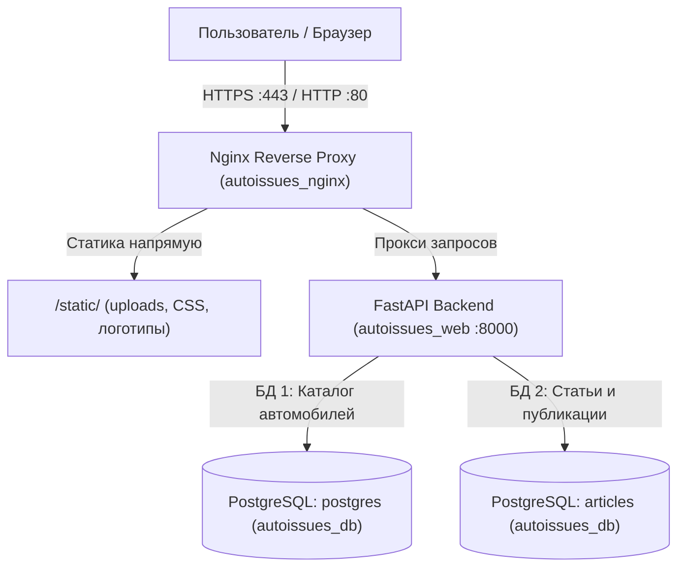

	# Руководство по эксплуатации и поддержке проекта «АвтоПроблема.ру»

> **Домен:** `https://aproblema.ru/`  
> **Стек:** FastAPI, PostgreSQL 16, Nginx, Docker Compose, Vanilla JS + CSS  
> **Сервер:** Ubuntu 24.04 LTS (VPS)

Документ содержит всю необходимую информацию для самостоятельной поддержки, обновления, администрирования и устранения неполадок проекта.

---

## 1. Архитектура сервисов

Проект развернут в трех изолированных Docker-контейнерах через `docker-compose.yml`:



1. **`autoissues_nginx` (Nginx:alpine)**:
   - Принимает внешний трафик на портах 80 и 443.
   - Обеспечивает SSL-шифрование (сертификаты Let's Encrypt).
   - Раздает статические файлы из `/static/` напрямую с диска без участия Python (максимальная скорость и кэширование 30 дней).
   - Лимит размера тела запроса: `client_max_body_size 15M;` (для загрузки фото высокого разрешения).
   - Защита от DoS через `limit_req_zone` (30 r/s с burst 50).
   - Проксирует API и динамические страницы в контейнер `web`.

2. **`autoissues_web` (FastAPI / Uvicorn)**:
   - Работает на порту 8000 внутри docker-сети.
   - Скомпонован из модульных роутеров: публичный каталог моделей, публичный блог статей и защищенная панель администратора.
   - Шаблонизатор Jinja2 динамически рендерит `templates/index.html` и `templates/admin.html`.

3. **`autoissues_db` (PostgreSQL 16)**:
   - Порт 5432 слушает **исключительно локальный адрес 127.0.0.1** (доступ из интернета закрыт).
   - Данные сохраняются в постоянный docker volume `pgdata`.
   - Содержит две независимые базы:
     * `postgres` — каталог 139 моделей автомобилей и база поломок.
     * `articles` — статьи, авторы, рубрики и счетчики просмотров.

---

## 2. Структура файлов проекта

| Файл / Директория | Назначение | Когда редактировать |
| :--- | :--- | :--- |
| `templates/index.html` | Публичный интерфейс сайта (каталог + статьи + адаптив) | Изменение верстки, дизайна, стилей, логики фильтров |
| `templates/admin.html` | Панель управления (`/admin`) | Настройка редактора, таблиц, кнопок управления |
| `api.py` | Главный файл приложения FastAPI, sitemap.xml, robots.txt | Добавление новых глобальных маршрутов |
| `admin_api.py` | API панели управления, загрузка файлов, автоочистка | Изменение логики создания/редактирования статей |
| `admin_auth.py` | Аутентификация админа, куки сессии, Rate Limiting логина | Настройка безопасности доступа к админке |
| `articles_public.py` | Публичный API статей (`/api/articles`) | Изменение правил выдачи статей, сортировок |
| `database.py` | Модели базы каталога автомобилей (SQLAlchemy) | Изменение структуры таблиц авто |
| `database_articles.py` | Модель базы статей `Article` | Добавление новых полей в статьи (теги, рейтинг) |
| `seo_renderer.py` | Серверная инъекция метатегов и Schema.org (SSR) | Корректировка SEO-шаблонов для поисковиков |
| `slug_service.py` | Генерация ЧПУ slug моделей и агрегатных узлов | Изменение структуры ЧПУ ссылок |
| `nginx/nginx.conf` | Конфигурация Nginx, SSL, кэширование, лимиты | Настройка доменов, перенаправлений, заголовков |
| `docker-compose.yml` | Описание сервисов, томов, портов и окружения | Добавление контейнеров, переменных |
| `scripts/backup_db.sh` | Скрипт автоматического бэкапа баз с ротацией 7 дней | Настройка резервного копирования |
| `static/uploads/articles/`| Физические файлы загруженных обложек статей | Локальное хранилище медиафайлов |
| `.env` | Пароли и секретные ключи | Смена паролей (не коммитится в Git!) |

---

## 3. Повседневные команды управления (Cheat-Sheet)

Все команды выполняются на VPS сервере в директории приложения (`~/app`):

### 3.1 Проверка состояния
```bash
# Статус контейнеров (все должны быть 'Up' / 'healthy')
sudo docker compose ps

# Просмотр логов веб-приложения в реальном времени
sudo docker compose logs -f web

# Просмотр последних 50 строк логов Nginx или Базы Данных
sudo docker compose logs --tail=50 nginx
sudo docker compose logs --tail=50 db
```

### 3.2 Обновление сайта из GitHub
```bash
cd ~/app
git pull origin main

# Если менялись ТОЛЬКО файлы в templates/ (HTML/JS):
# Рестарт НЕ ТРЕБУЕТСЯ, шаблоны перечитываются на лету!

# Если менялись файлы Python (*.py), requirements.txt или nginx.conf:
sudo docker compose restart web
```

### 3.3 Полный перезапуск и пересборка
```bash
# Обычный перезапуск
sudo docker compose down && sudo docker compose up -d

# Пересборка при обновлении библиотек в requirements.txt или Dockerfile
sudo docker compose up -d --build
```

---

## 4. Резервное копирование и восстановление (Бэкапы)

В проекте настроен автоматический скрипт резервного копирования `scripts/backup_db.sh`.

### Ручное создание бэкапа
```bash
# Запуск скрипта бэкапа обеих баз данных:
bash ~/app/scripts/backup_db.sh
```
Бэкапы сохраняются в директорию `~/backups/` в сжатом виде (`.sql.gz`) и автоматически ротируются (удаляются файлы старше 7 дней).

### Ручной дамп одной конкретной базы
```bash
# Каталог машин:
sudo docker exec -t autoissues_db pg_dump -U autouser postgres | gzip > ~/backup_postgres_$(date +%F).sql.gz

# База статей:
sudo docker exec -t autoissues_db pg_dump -U autouser articles | gzip > ~/backup_articles_$(date +%F).sql.gz
```

### Восстановление из бэкапа
```bash
# Восстановление каталога:
gunzip -c ~/backup_postgres_YYYY-MM-DD.sql.gz | sudo docker exec -i autoissues_db psql -U autouser -d postgres

# Восстановление статей:
gunzip -c ~/backup_articles_YYYY-MM-DD.sql.gz | sudo docker exec -i autoissues_db psql -U autouser -d articles
```

### Добавление автобэкапа в cron (каждую ночь в 03:00)
```bash
crontab -e
# Добавить строку:
0 3 * * * /bin/bash /home/ubuntuuser/app/scripts/backup_db.sh >> /home/ubuntuuser/backups/backup.log 2>&1
```

---

## 5. Безопасность и настройки окружения (`.env`)

Файл `.env` лежит на сервере в `~/app/.env` и содержит чувствительные данные:

```env
# Подключение к базам данных
DATABASE_URL=postgresql+psycopg2://autouser:AutoUser2026_SecureKey_#98@db:5432/postgres
ARTICLES_DATABASE_URL=postgresql+psycopg2://autouser:AutoUser2026_SecureKey_#98@db:5432/articles

# Доступ к панели администратора (/admin)
ADMIN_USERNAME=admin
ADMIN_PASSWORD=ваш_сложный_пароль
SECRET_KEY=секретная_криптографическая_строка_сессий

ENVIRONMENT=production
```

> **Важно:** После любого изменения файла `.env` обязательно перезапустите сервис:
> `sudo docker compose restart web`

### Меры безопасности, заложенные в код:
1. **База данных под пользователем с ограниченными правами**: Приложение работает под пользователем `autouser`, а не под root-пользователем `postgres`.
2. **Сессии администратора**: Подписаны криптографическим алгоритмом HMAC SHA-256 с солью, передаются в куках с флагами `HttpOnly` и `SameSite=Lax`.
3. **Rate Limiting**:
   - Форма входа в админку: максимум 5 попыток в минуту с одного IP.
   - Форма обратной связи: максимум 3 отправки за 10 минут.
4. **Валидация файлов при загрузке**: Проверяются не только расширения, но и бинарные сигнатуры (magic bytes), что предотвращает загрузку вредоносных скриптов под видом картинок.

---

## 6. Загрузка медиа и автоочистка диска

- **Куда загружаются обложки:** папка `static/uploads/articles/`. Она смонтирована напрямую в хост-систему и в оба контейнера (`web` и `nginx`).
- **Nginx лимит:** в `nginx.conf` установлен `client_max_body_size 15M;`.
- **Автоматическая очистка диска:**
  * При замене обложки в статье старый файл в `/static/uploads/articles/` автоматически удаляется.
  * При удалении статьи файл обложки также удаляется.
  * Внешние ссылки (на сторонние сайты) не затрагиваются.
  * Если файл используется в другой статье, он сохраняется.

---

## 7. Как устроен SEO и поисковая оптимизация

Проект использует **Server-Side Rendering (SSR)** инъекции:
1. При обращении роботов Яндекса или Google по адресу `/cars/{slug}` или `/articles/{slug}` сервер в `api.py` и `seo_renderer.py` перехватывает запрос и наполняет HTML-шаблон:
   - `<title>` и `<meta name="description">`
   - OpenGraph теги (`og:title`, `og:image`, `og:description`, `og:url`)
   - Микроразметку Schema.org в формате JSON-LD (`Article`, `BreadcrumbList`, `FAQPage`)
   - Семантический контент прямо в тело ответа до старта JavaScript.
2. Файл `sitemap.xml` генерируется динамически на лету по адресу `/sitemap.xml` и автоматически включает все 139 моделей и все опубликованные статьи.
3. Файл `robots.txt` доступен по адресу `/robots.txt` со ссылкой на карту сайта.

---

## 8. Чек-лист устранения неполадок (Troubleshooting)

| Симптом | Причина | Способ решения |
| :--- | :--- | :--- |
| **502 Bad Gateway** | Упал контейнер `autoissues_web` | Проверьте логи: `sudo docker compose logs --tail=100 web`. Обычно вызвана опечаткой в Python-файле или нехваткой RAM. |
| **Not Found (404) при обращении к новому API** | Изменения в `.py` файлах скачаны через `git pull`, но контейнер крутит старую версию в RAM | Выполните `sudo docker compose restart web`. |
| **Permission denied for schema public** | В PostgreSQL у пользователя `autouser` сбились права на схему | Выполните: `sudo docker exec -i autoissues_db psql -U postgres -d articles -c "GRANT ALL ON SCHEMA public TO autouser; ALTER SCHEMA public OWNER TO autouser;"` |
| **Ошибка 413 Request Entity Too Large** | Попытка загрузить картинку больше лимита Nginx | Убедитесь, что в `nginx/nginx.conf` стоит `client_max_body_size 15M;`, затем выполните `sudo docker compose restart nginx`. |
| **Сайт недоступен по HTTPS (ошибка сертификата)** | Истек срок действия сертификата Let's Encrypt | `sudo certbot renew && sudo docker compose restart nginx`. |
| **Закончилось свободное место на VPS** | Накопились старые неиспользуемые docker-образы и логи | Проверьте: `df -h`. Очистите кэш Docker: `sudo docker system prune -af --volumes`. |
