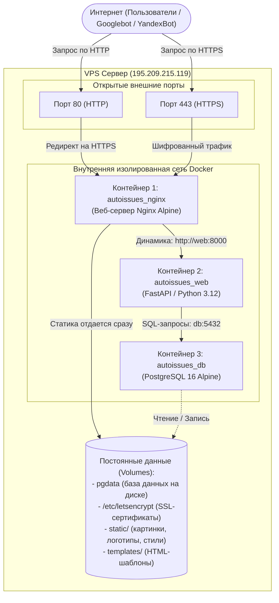
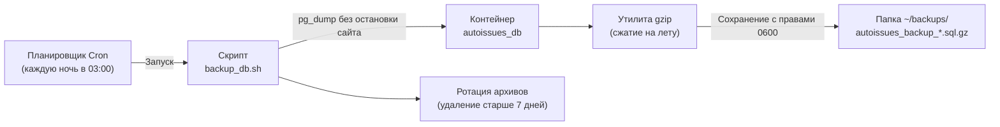

# Руководство по архитектуре проекта «АвтоПроблема.ру»

Данный документ описывает внутреннее устройство сайта, назначение каждого компонента инфраструктуры, сетевое взаимодействие между Docker-контейнерами и жизненный цикл обработки пользовательских запросов.

---

## 1. Базовая концепция: Что такое Docker и зачем он нужен

Для понимания архитектуры удобно использовать следующую аналогию:

* **VPS (виртуальный сервер в облаке)** — это земельный участок с внешним адресом `195.209.215.119`.
* **Docker** — это строительная технология стандартных изолированных контейнеров (морских контейнеров).
* **Контейнеры** — это три изолированные комнаты внутри участка. Каждая комната живет своей жизнью, имеет свои программы, но они соединены внутренней локальной связью.

### Зачем контейнеры проекту:
1. **Изоляция:** если упадет веб-сервер, база данных не повредится.
2. **Предсказуемость:** проект работает одинаково на локальном компьютере и на удаленном сервере Ubuntu, независимо от версии установленных в системе пакетов.
3. **Безопасность:** база данных и бэкенд спрятаны во внутренней сети Docker и недоступны напрямую из внешнего интернета.

---

## 2. Три ключевых контейнера системы

Проект состоит из трех сервисов, описанных в файле `docker-compose.yml`:



---

### Контейнер 1: `autoissues_nginx` (Швейцар и регулировщик)
* **Технология:** Nginx на базе Alpine Linux.
* **Роль:** Первая линия обороны и распределитель трафика (Reverse Proxy).
* **Что делает:**
  1. Принимает входящие запросы из интернета на портах `80` (HTTP) и `443` (HTTPS).
  2. Занимается SSL-шифрованием (расшифровывает HTTPS с помощью сертификатов Let's Encrypt).
  3. Отдает статические файлы (логотип, иконки, favicon) напрямую с диска за доли миллисекунды, не тревожа Python.
  4. Фильтрует вредоносный трафик и защищает от DoS через Rate Limiting (до 30 запросов в секунду).
  5. Сжимает ответы алгоритмом Gzip для ускорения открытия сайта на телефонах.
  6. Перенаправляет все осмысленные запросы страниц и API во второй контейнер по внутреннему имени `http://web:8000`.

---

### Контейнер 2: `autoissues_web` (Мозг и логика)
* **Технология:** Python 3.12, фреймворк FastAPI, сервер Uvicorn.
* **Роль:** Обработка бизнес-логики, поисковой оптимизации и выдача данных.
* **Что делает:**
  1. Реализует эндпоинты каталога (`/api/cars`, `/api/catalog-tree` и др.).
  2. Выполняет **Server-Side Rendering (SSR)**: когда робот поисковика или пользователь запрашивает `/cars/haval-jolion`, модуль `seo_renderer.py` генерирует готовый HTML с метатегами, OpenGraph, JSON-LD микроразметкой и списком проблем до отработки клиентского JS.
  3. Защищает форму обратной связи от спама через `InMemoryRateLimiter` (максимум 3 отправки за 10 минут с одного IP).
  4. Формирует динамический `sitemap.xml` со всеми 1 255 ссылками.

---

### Контейнер 3: `autoissues_db` (Сейф с данными)
* **Технология:** Реляционная СУБД PostgreSQL 16.
* **Роль:** Надежное хранение каталога автомобилей и зафиксированных неисправностей.
* **Что хранит:**
  * Таблица `cars` — 139 моделей автомобилей с их характеристиками, странами и поколениями.
  * Таблица `car_issues` — 1 472 структурированные проблемы с пробегами, симптомами и уровнями критичности.
  * Таблица `raw_reviews` — 829 исходных отзывов владельцев.
* **Особенность хранения:** данные базы лежат не внутри контейнера, а в постоянном хранилище хоста (`docker volume: pgdata`). Если контейнер удалить или обновить, база данных не сотрется.

---

## 3. Путь одного запроса: Как открывается страница

Ниже показана последовательность шагов, когда посетитель или робот Googlebot переходит по адресу `https://aproblema.ru/cars/haval-jolion`:

```mermaid
sequenceDiagram
    autonumber
    actor User as Браузер / Googlebot
    participant Nginx as autoissues_nginx (:443)
    participant FastAPI as autoissues_web (:8000)
    participant DB as autoissues_db (:5432)

    User->>Nginx: GET /cars/haval-jolion (HTTPS)
    Note over Nginx: Проверка SSL-сертификата<br/>Проверка Rate Limit (30 r/s)<br/>Проверка: статика или динамика?
    
    Nginx->>FastAPI: Проксирование: GET /cars/haval-jolion
    Note over FastAPI: Определение slug 'haval-jolion' -> car_id=24
    
    FastAPI->>DB: SQL: SELECT * FROM cars WHERE id=24;<br/>SELECT * FROM car_issues WHERE car_id=24;
    DB-->>FastAPI: Данные по модели и 7 зафиксированным проблемам
    
    Note over FastAPI: Генерация Server-Side SEO:<br/>- Title & Meta description<br/>- JSON-LD FAQPage & Car<br/>- H1 & карточки дефектов в HTML
    
    FastAPI-->>Nginx: 200 OK (Сгенерированный HTML)
    Note over Nginx: Gzip-сжатие HTML-ответа<br/>Добавление Security Headers
    Nginx-->>User: Отдача готовой страницы браузеру
```

---

## 4. Контур безопасности проекта

Безопасность выстроена по принципу эшелонированной обороны (Defense in Depth):

1. **Закрытые порты (Network Isolation):**
   * Порт базы данных `5432` привязан строго к `127.0.0.1`. Из интернета к базе подключиться невозможно.
   * Порт бэкенда `8000` вообще не опубликован наружу — он существует только внутри виртуальной сети Docker.
   * Единственные двери в систему — порты `80` и `443` Nginx.

2. **Защита от спама и DoS:**
   * **Глобально (Nginx):** не более 30 запросов в секунду с одного IP-адреса.
   * **Форма связи (FastAPI):** не более 3 отправок сообщений за 10 минут с одного реального IP (вычисляется из `X-Forwarded-For`).
   * **Honeypot-ловушка:** скрытое поле для отлова ботов без расходования ресурсов сервера.

3. **Заголовки безопасности браузера:**
   * Запрет встраивания сайта во фреймы других ресурсов (защита от Clickjacking: `SAMEORIGIN`).
   * Запрет браузеру подменять MIME-типы (`nosniff`).
   * Принудительный HTTPS на 1 год вперед (`HSTS`).
   * Запрет доступа к камере, микрофону и геолокации (`Permissions-Policy`).

---

## 5. Как устроен автоматический бэкап и Cron

Каждую ночь в 03:00 системный планировщик задач **Cron** на сервере запускает скрипт `scripts/backup_db.sh`:



### Преимущества такой схемы:
* **Без простоя:** база данных не выключается во время снятия копии.
* **Экономия места:** дамп сжимается в архив `.sql.gz` в процессе создания.
* **Автономность:** старые копии автоматически удаляются через 7 дней, диск не забьется.

---

## 6. Основные команды для управления сайтом

Все действия выполняются из директории `~/app` на сервере:

* **Посмотреть состояние контейнеров:**
  ```bash
  sudo docker compose ps
  ```
* **Посмотреть логи веб-сервера или Nginx в реальном времени:**
  ```bash
  sudo docker compose logs -f web
  sudo docker compose logs -f nginx
  ```
* **Перезапустить проект без пересборки:**
  ```bash
  sudo docker compose restart
  ```
* **Полная пересборка и обновление после `git pull`:**
  ```bash
	sudo docker compose down
  sudo docker compose up -d --build
  ```
* **Ручной запуск бэкапа базы данных:**
  ```bash
  ~/app/scripts/backup_db.sh
  ```

ГАЙД ПО УПРАВЛЕНИЮ САЙТОМ [[maintenance_guide]]